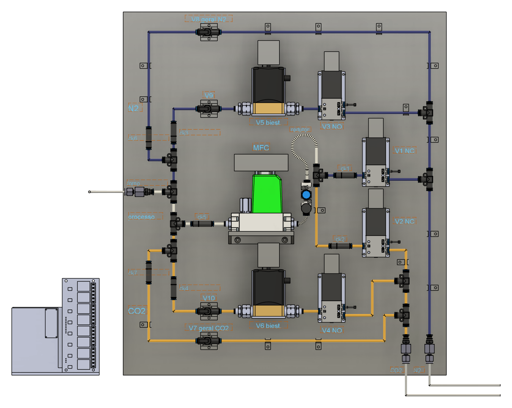
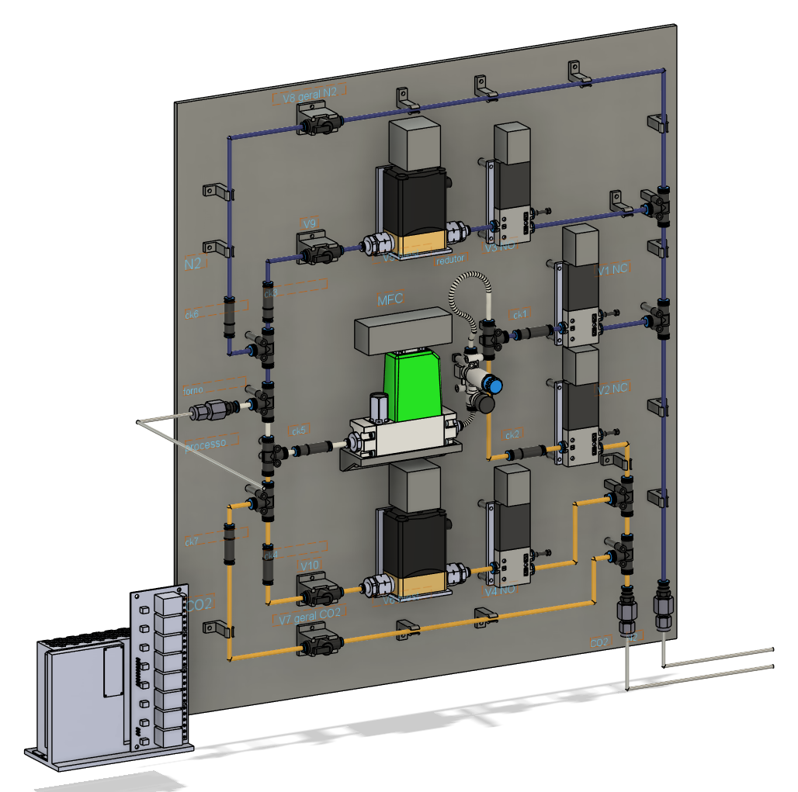
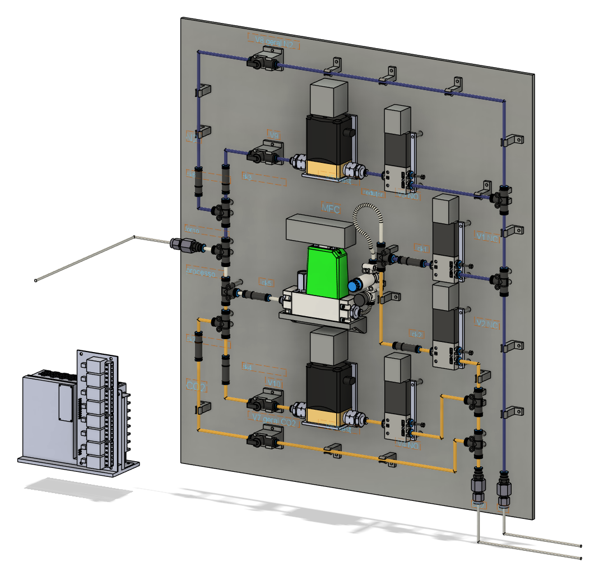
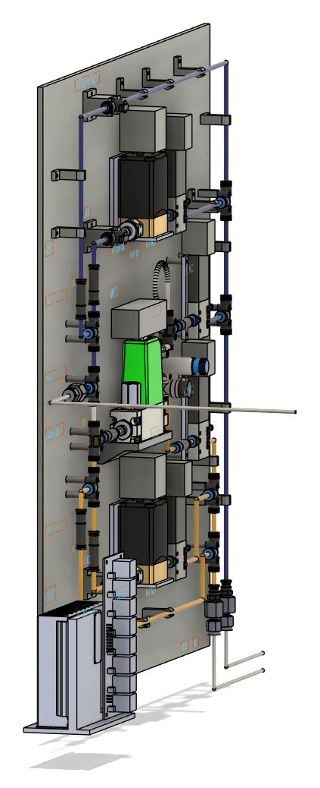
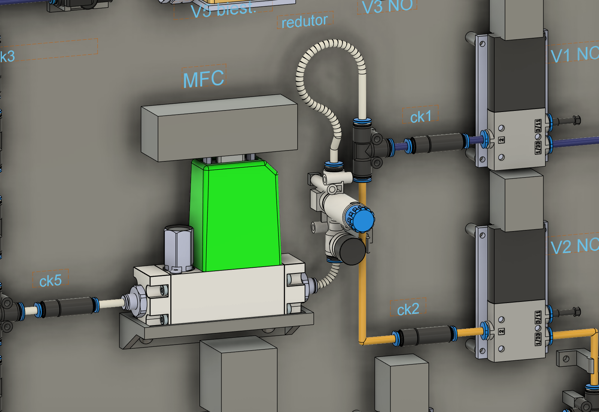
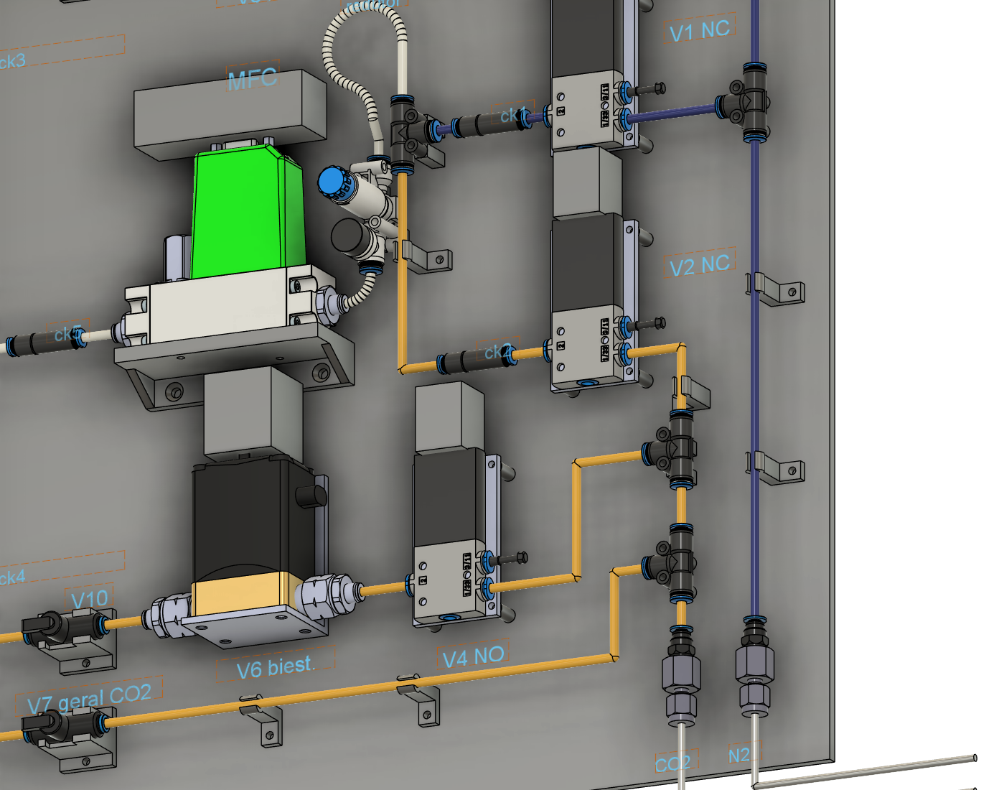

# Painel de gases

Modelo 3D interativo da entrada de gases do forno de pirólise do projeto CarbonTech: garrafas de
N₂ e CO₂, válvulas, controlador de caudal (MFC) e entrada do forno, como vão ser montados: forno à
esquerda, garrafas à direita e as válvulas numa caixa de 50 × 70 × 20 cm logo atrás do forno.
Clica-se nas válvulas e vê-se por onde passa o gás, também numa falha de energia.

Página: https://mauroleme.github.io/painel-gases/

Esquema ilustrativo, com medidas assumidas. A página é um único ficheiro, `entrada_gases_3d.html`,
que funciona sem instalar nada; para a atualizar, substitui-se esse ficheiro por uma versão nova.

Modelo CAD: `painel_valvulas.step` é a montagem do painel feita no Fusion, com as peças dos
fabricantes (válvulas Festo e Bürkert, redutor Festo VRPA, MFC Sensirion, uniões) e as cores
originais. Abre-se em qualquer programa de CAD (Fusion, SolidWorks, FreeCAD).

## Vistas do modelo CAD

O painel de pé, como fica montado: N₂ em cima (azul), CO₂ em baixo (laranja), saída para o
forno à esquerda e entradas das garrafas em baixo à direita.

| | |
|---|---|
|  |  |

MFC, redutor de pressão VRPA e T de junção:

Válvulas NC (V1, V2), V4 e entradas das garrafas:

